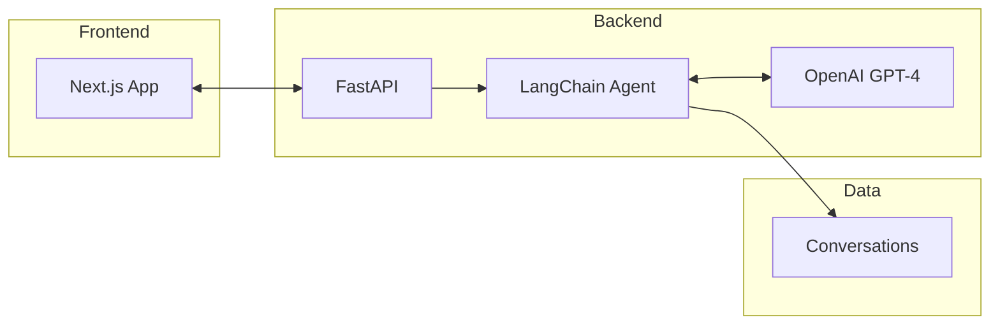

# Solution Architecture

A conversational AI assistant that analyzes conversations and extracts insights using LLM technology.

## Overview

## Components

| Component | Technology | Purpose |
|-----------|------------|---------|
| **Frontend** | Next.js + React | User interface |
| **Backend** | FastAPI | REST API server |
| **AI Agent** | LangChain | Orchestrates LLM calls |
| **LLM** | OpenAI GPT-4 | Generates insights |

## API Endpoints

- `/api/conversations` - Manage conversations
- `/api/insights` - Extract insights from conversations
- `/api/questions` - Ask questions about conversations
- `/api/analysis` - Run analysis on conversation data

## How It Works

1. User submits a conversation or question via the UI
2. Frontend sends request to FastAPI backend
3. LangChain agent processes the request with GPT-4
4. Insights are returned and displayed to the user
